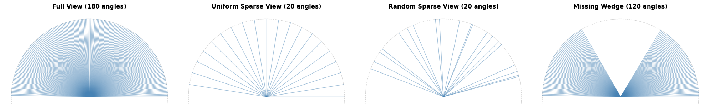
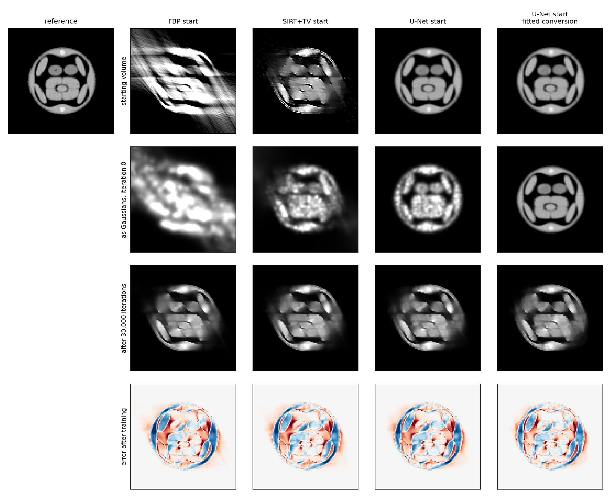
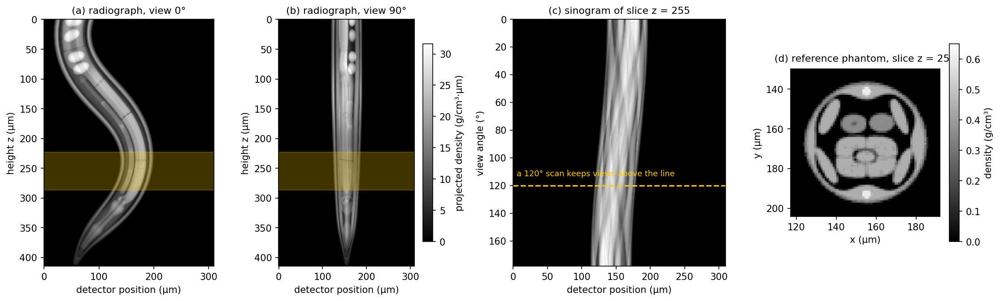
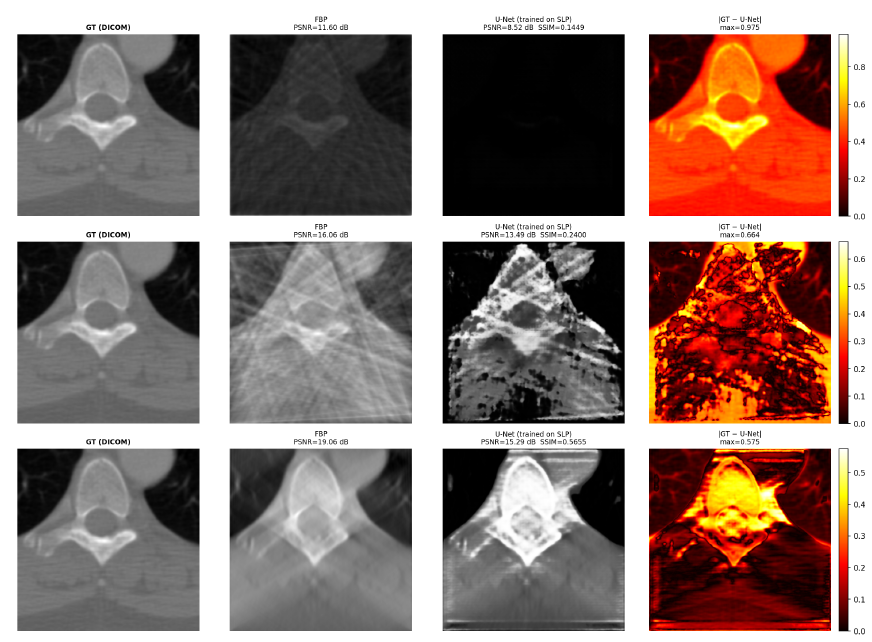
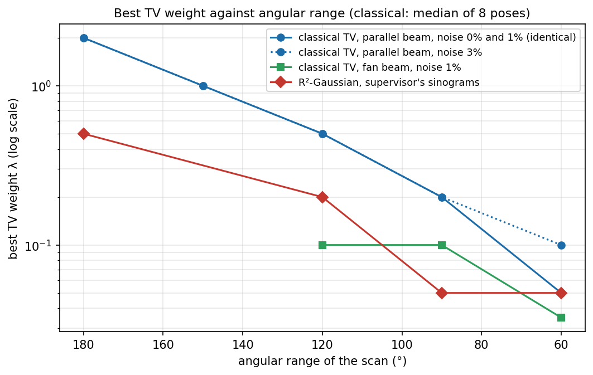
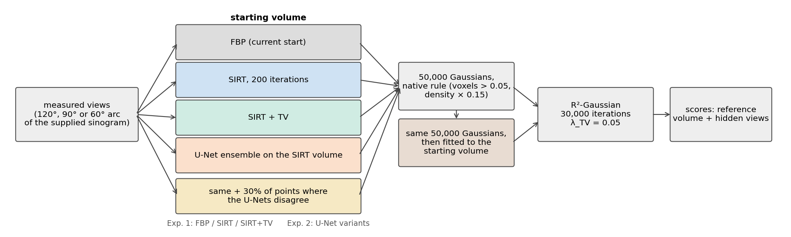
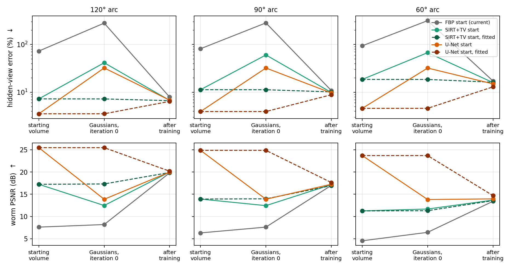

# U-Net restoration and 3D Gaussian reconstruction for sparse-view and limited-angle CT

Research project at LaBRI, Université de Bordeaux (M.Sc. IPCVai, February 2026 to now).
Joint work with Md Zunayedul Islam, supervised by Dr. Pascal Desbarats and
Anna-Louise Brun.

A CT scan needs fewer X-ray projections, and so less radiation dose, if the reconstruction can cope with the missing
data. We study two cases: **sparse-view CT** (20 projections instead of 1000+) and **limited-angle CT** (a whole range
of angles is missing). The project asks how far a learned prior, here a U-Net, can help a 3D Gaussian Splatting
reconstruction, and where that help is lost. All experiments, tables and figures are in the reports in
[`reports/`](reports/).



*Full view, uniform sparse view, random sparse view and missing wedge (limited angle).*

## Summary

- A residual U-Net trained to turn a limited-angle slice into the full-angle one reduces the density error inside the
  object by 83 % on scans it was not trained on (for example from 0.140 to 0.023 g/cm³ at a 60° arc).
- Used as the starting point of R²-Gaussian, the U-Net output gives the best reconstruction at every arc:
  +0.38, +0.64 and +1.27 dB PSNR at 120°, 90° and 60° against the default filtered back-projection (FBP) start, and the
  error on views that were never measured falls from 17.1 % to 12.9 % at 60°. The gain is positive on all nine
  test cases. Two runs with different seeds differ by 0.04 dB.
- A good start is lost in two places. The standard conversion from a volume to Gaussians turns a 25 dB U-Net volume
  into a 14 dB set of Gaussians, which we fixed by fitting the Gaussians to the volume. After that, training itself
  removes most of what remains, and no choice of start fixes this.
- The best total-variation (TV) weight depends on the scan. It falls from 0.5 at 180° to 0.05 at 60°. A rule that
  only uses the missing angular fraction picks a weight within 0.24 dB of the best one on 102 scans of poses not used
  for tuning. One fixed weight loses 0.50 dB.
- We trained one U-Net per acquisition setting in every study, and a U-Net trained on phantoms failed on a real
  vertebra slice (8.5 dB). Fixed weights do not carry over between scan settings or anatomies.
- Uncertainty that only covers Gaussian densities is far too confident: its 95 % intervals contain the true value
  41 to 45 % of the time on known phantoms. Adding the uncertainty of Gaussian positions brings this to 95 %.



*One slice at a 60° arc. Rows: starting volume, the initial Gaussians, the result after training, and its error. The
U-Net start is far better than FBP or SIRT+TV, and only the fitted conversion (right) keeps it when the volume is turned
into Gaussians.*

## 1. Problem

Filtered back-projection needs many projections over the full angular range. With 20 views it produces streaks. With a
limited arc, edges whose normals lie in the missing directions are not seen by the data at all, and the image is smeared
along those directions. Iterative methods (SART, SIRT) and TV regularisation reduce the artefacts but cannot bring back
structure that no view constrained.

Gaussian Splatting methods for CT (3DGR-CT, R²-Gaussian) describe the density as a sum of 3D Gaussians and fit them to
the measured projections. They need no training data, but with missing angles they fit the measured views well and
still get the missing directions wrong. A network trained on similar objects knows something the measured views do not
contain. The project looks at how to bring that knowledge into the reconstruction, and at how reliable the result is.

## 2. Questions

| # | Question | Report |
|---|---|---|
| 1 | How well do FBP, SART, SIRT and 2D Gaussian Splatting reconstruct from 20 views or with a missing wedge? | Section 4.1 |
| 2 | Can a U-Net give Gaussian Splatting a better start, and what happens on anatomy it has not seen? | Section 4.1 |
| 3 | In 3D, how much does a limited arc cost, and does the orientation of the arc matter? | [chest pilot](reports/chest_limited_angle_pilot.pdf), [controls](reports/chest_reproduction_and_controls.pdf) |
| 4 | Is one TV weight right for every scan? Can it be chosen without ground truth? | [TV weight](reports/tv_weight_vs_angular_range.pdf) |
| 5 | Does a better starting volume (SIRT, SIRT+TV, U-Net) give a better final R²-Gaussian reconstruction? | [U-Net starts](reports/unet_starting_points_limited_angle_ct.pdf) |
| 6 | Can the Gaussian reconstruction say where it is uncertain? | [uncertainty](reports/gaussian_uncertainty_limited_angle_ct.pdf) |

## 3. Data

| Data | Used for | Notes |
|---|---|---|
| Shepp-Logan phantom, 256 × 256 | 2D sparse-view study, U-Net training | 1,000 augmented pairs (rotation, intensity scaling, Gaussian noise) |
| One clinical vertebra slice (DICOM) | 2D sparse-view study, test only | Never seen in training |
| Synthetic chest volume, 256³, from the R²-Gaussian dataset | 3D limited-angle pilot | Cone beam, projections generated with TIGRE, no noise |
| 144 synthetic worm scans (parallel beam, 100 views over 180°, 1 µm sampling) | TV, U-Net start and uncertainty studies | Different poses of one worm model, provided by Anna-Louise Brun. Not included in this repository |

Limited-angle scans are made by keeping the views of one arc (120°, 90° or 60°). The views outside the arc are never
shown to any method and are only used for scoring. Where noise was studied, it is additive Gaussian noise of 1 %, 3 %
or 5 % of the signal RMS on the sinogram.



## 4. What we did

### 4.1 Sparse-view CT in 2D: Gaussian Splatting with a U-Net start

We wrote a 2D Gaussian Splatting reconstruction from scratch. Each slice is a mixture of 8,000 to 12,000 Gaussians.
A differentiable parallel-beam projector (ASTRA, with a custom autograd function) compares them with the measured
sinogram, and Gaussians are cloned, split and pruned during training. Baselines are FBP, SART and SIRT.

A U-Net (1.9 M parameters) trained on Shepp-Logan pairs to map the FBP image to the clean image was then used to place
the initial Gaussians. We trained one U-Net per acquisition geometry. On the vertebra slice the U-Net breaks down:

| Geometry | U-Net output on the vertebra slice (PSNR) |
|---|---|
| Uniform sparse view, 20 angles | 8.52 dB |
| Random sparse view, 20 angles | 13.49 dB |
| Missing wedge, 120 angles | 15.29 dB |



*Ground truth, FBP input, U-Net output and error. The U-Net learned the streak pattern of the phantom and maps the
bone streaks of the real slice to almost nothing.*

Starting the Gaussians from this output gave 12.5 dB, against 25.7 dB from the plain FBP start. We replaced the output
layer by an evidential head (Normal-Inverse-Gamma), which predicts a mean and a per-pixel epistemic and aleatoric
uncertainty in one forward pass. Even where the mean is wrong, the uncertainty map follows the anatomy, so part of the
Gaussians are placed where it is high. Two signals measured at inference time (quality of the mean, and how
concentrated the uncertainty is) decide how much to trust the U-Net and fall back to FBP when it has failed.

| Geometry | FBP start | Evidential U-Net start |
|---|---|---|
| Uniform sparse view | 26.11 dB | 27.90 dB |
| Random sparse view | 23.33 dB | 22.69 dB |
| Missing wedge | 18.35 dB (best checkpoint, 13.06 dB at the last iteration) | 21.35 dB |

These numbers come from one slice and one run each. They show that the start matters and that a learned start needs
a check on whether it can be trusted. They are not a general claim that the evidential start is better.

### 4.2 Limited-angle CT in 3D with R²-Gaussian

We moved to 3D with the public R²-Gaussian code. On a synthetic chest volume with 50 views, restricting the scan from
360° to 120° lowers PSNR from 35.55 to 30.91 dB, and rotating the same 120° arc by 90° lowers it again to 28.59 dB.
The runs were reproduced on a second GPU within 0.014 dB, and a second seed moves PSNR by 0.047 dB. Starting both
orientations from the same initial volume leaves the 2.3 dB difference unchanged, so it comes from the measurements.
Inside the body the two orientations are equally accurate (29.98 and 30.01 dB). The difference sits in the band that
contains the patient's back and the CT table.

### 4.3 The best TV weight depends on the scan

On the worm data we swept the TV weight for four angular ranges.

| Scan | Best TV weight (R²-Gaussian) | PSNR at the best weight | PSNR at the chest weight 0.05 |
|---|---|---|---|
| 180° | 0.5 | 25.15 dB | 22.60 dB |
| 120° | 0.2 | 20.04 dB | 19.87 dB |
| 90° | 0.05 | 17.02 dB | 17.02 dB |
| 60° | 0.05 | 13.66 dB | 13.66 dB |



A classical TV solver on eight poses shows the same trend, in parallel beam and in fan beam, and with up to 3 % noise.
With complete data, strong TV removes artefacts and the measurements keep the shape correct. With a large missing
wedge, strong TV fills the unconstrained directions with flat regions that need not be right.

Since the weight follows the acquisition, it can be predicted from it. We compared five ways of choosing the weight
without ground truth, on 102 scans of four poses that were not used for tuning:

| Rule | PSNR lost against the best weight |
|---|---|
| Rule based on the missing angular fraction | 0.24 dB |
| One fixed weight | 0.50 dB |
| Cross-validation on held-out measured views | 0.58 dB |
| L-curve | 0.91 dB |
| Discrepancy principle | 3.48 dB |

Applied without change to fan-beam scans, the angle rule still loses 0.24 dB, against 1.15 dB for the fixed weight.

### 4.4 U-Net starting volumes for R²-Gaussian

R²-Gaussian draws its initial Gaussians from an FBP of the measured views. With a limited arc this volume is mostly
streaks, and only about 10 % of the initial Gaussians fall inside the object. We kept the training unchanged and only
replaced the start.



- **Starts from the measured views only:** SIRT, and a TV-regularised reconstruction (SIRT+TV).
- **Learned start:** a residual 2D U-Net (four levels, 32 to 256 channels, output = input + correction) that maps the
  limited-arc SIRT slice to the full-arc SIRT slice. One U-Net per arc, three seeds each, and the start is the mean of
  the three. Training uses 115 other poses. The three test poses, and every pose that correlates above 0.9 with one of
  them, were removed before training.
- **Fitted conversion:** the standard rule keeps where the object is but not its density pattern. We instead optimised
  the 50,000 initial Gaussians until they reproduce the starting volume, then started the normal training.

The U-Net on validation poses (mean density error inside the object, g/cm³):

| Arc | SIRT input | U-Net output |
|---|---|---|
| 120° | 0.064 | 0.011 |
| 90° | 0.096 | 0.016 |
| 60° | 0.140 | 0.023 |

Final R²-Gaussian results after 30,000 iterations, mean of three poses:

| Arc | Start | PSNR inside the object | Gain over FBP start | Error on unmeasured views |
|---|---|---|---|---|
| 120° | FBP (default) | 19.81 dB | | 7.92 % |
| 120° | SIRT+TV | 20.00 dB | +0.19 dB | 6.75 % |
| 120° | U-Net | 20.00 dB | +0.19 dB | 6.80 % |
| 120° | U-Net, fitted | **20.19 dB** | **+0.38 dB** | **6.40 %** |
| 90° | FBP (default) | 17.00 dB | | 10.83 % |
| 90° | SIRT+TV | 17.16 dB | +0.17 dB | 9.84 % |
| 90° | U-Net | 17.25 dB | +0.26 dB | 9.62 % |
| 90° | U-Net, fitted | **17.64 dB** | **+0.64 dB** | **8.82 %** |
| 60° | FBP (default) | 13.42 dB | | 17.12 % |
| 60° | SIRT+TV | 13.69 dB | +0.26 dB | 15.85 % |
| 60° | U-Net | 13.96 dB | +0.54 dB | 14.91 % |
| 60° | U-Net, fitted | **14.69 dB** | **+1.27 dB** | **12.92 %** |



*Each start followed through three stages: starting volume, initial Gaussians, result after training.*

Placing 30 % of the Gaussians where the three U-Nets disagree most did not help (+0.02, 0.00 and +0.06 dB, which is
at the level of the seed spread).

### 4.5 Uncertainty of the Gaussian reconstruction

For a reconstruction with missing views, a good fit to the measured data says little about the rest. We tested whether
the Gaussian model can report its own uncertainty, with projection noise and with views held back for scoring.

- On the worm, a posterior over the Gaussian densities only (positions and shapes fixed) is overconfident. Its 95 %
  intervals contain 31 % and 24 % of the held-back noisy rays at 120° and 90°.
- On known 3D phantoms the cause is clear. With densities only, coverage is 41 to 45 %. Adding the uncertainty of the
  Gaussian centres gives 95 to 97 %. Adding widths and rotations is needed when the shapes are unknown.
- If the model lacks a component that the object has, coverage drops again (9 to 29 %), and it recovers when the
  component is restored.
- On the worm with a small 16-Gaussian model, the fits from different starts did not agree, so we report no calibrated
  uncertainty there yet. More Gaussians lowered the error on measured views (11.2 % to 8.4 %) and raised it on
  held-back views (19.8 % to 23.8 %).

## 5. What we take from it

1. A network trained on similar objects carries information about the missing directions that no reconstruction from
   the measured views alone can have. The U-Net volume on its own scored better than every R²-Gaussian result in the
   U-Net study.
2. That information has to survive two steps: the conversion to Gaussians, which the fitted conversion solves, and the
   training, which currently pulls the result back towards what the measured views allow.
3. Settings tuned for one acquisition are not right for another. This holds for the TV weight, and we also ended up
   with one U-Net per arc and per geometry. A next step is one model that takes the acquisition (arc, noise level) as
   an input and adapts to it, for example through FiLM layers or a hypernetwork, in place of one network per case.
4. Fitting the measured views is not a measure of quality when views are missing. The error on held-back views and
   scores inside the object tell more than whole-volume PSNR.

## 6. Limits

- All 3D data are synthetic. The worm scans are poses of one worm model, so the U-Net has seen this anatomy many
  times. The results show what a well-matched learned prior can do, not what to expect on a different specimen.
- The worm scans contain projections only. Scores inside the object use a reference built from the full-angle data.
  The error on unmeasured views does not use this reference, and it gives the same ranking.
- The U-Net studies use noise-free data. Noise was only studied for the TV weight and the uncertainty model, and it is
  additive Gaussian noise, not a scanner noise model.
- The 2D study uses one clinical slice and single runs.

## 7. Repository layout

```
sparse_view_2d/      2D Gaussian Splatting, ASTRA projector, U-Net and evidential U-Net start (notebooks)
limited_angle_3d/    R²-Gaussian experiments on the chest volume (pilot, TV controls, reproduction)
tv_weight/           TV sweeps, classical TV solver, rules for choosing the weight
unet_start/          U-Net training, starting volumes, fitted conversion, scoring
uncertainty/         density and joint posteriors, phantom and worm experiments
patches/             parallel-beam projection scaling fix for the official R²-Gaussian code
reports/             the project reports (PDF)
figures/             figures used in this README
```

The scripts are run from inside the official R²-Gaussian repository (see each folder's README). The worm scans, the
chest volume and the DICOM slice are not included.

## 8. Environment

Python 3.9, PyTorch 2.1.2 with CUDA 11.8, ASTRA Toolbox, TIGRE 2.3, NumPy, SciPy and scikit-image. The 3D runs used
an NVIDIA RTX 4000 Ada (20 GB) and were reproduced on an RTX 3060 (12 GB). The 3D experiments build on the official
[R²-Gaussian](https://github.com/Ruyi-Zha/r2_gaussian) code, which has to be installed first.

## 9. Reports

| Report | Content |
|---|---|
| [U-Net starting points](reports/unet_starting_points_limited_angle_ct.pdf) | Section 4.4 |
| [TV weight against angular range](reports/tv_weight_vs_angular_range.pdf) | Section 4.3 |
| [Uncertainty of the Gaussian reconstruction](reports/gaussian_uncertainty_limited_angle_ct.pdf) | Section 4.5 |
| [Chest pilot](reports/chest_limited_angle_pilot.pdf), [TV controls](reports/chest_tv_controls.pdf), [reproduction and controls](reports/chest_reproduction_and_controls.pdf) | Section 4.2 |

## 10. Built on

- R. Zha et al., *R²-Gaussian: Rectifying Radiative Gaussian Splatting for Tomographic Reconstruction*, NeurIPS 2024.
- Y. Li et al., *3DGR-CT: Sparse-view CT reconstruction with a 3D Gaussian representation*, Medical Image Analysis 2025.
- A. Amini et al., *Deep Evidential Regression*, NeurIPS 2020.
- [ASTRA Toolbox](https://astra-toolbox.com/) and [TIGRE](https://github.com/CERN/TIGRE) for the projectors.
